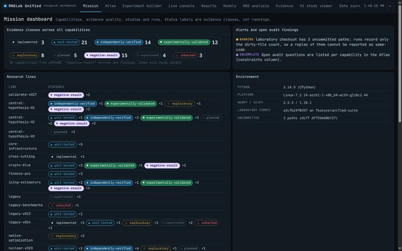
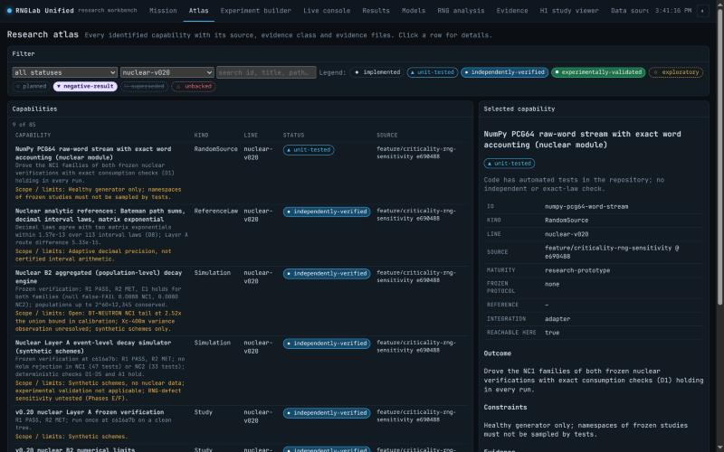
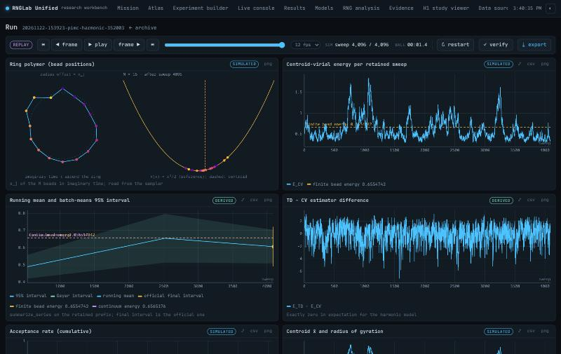
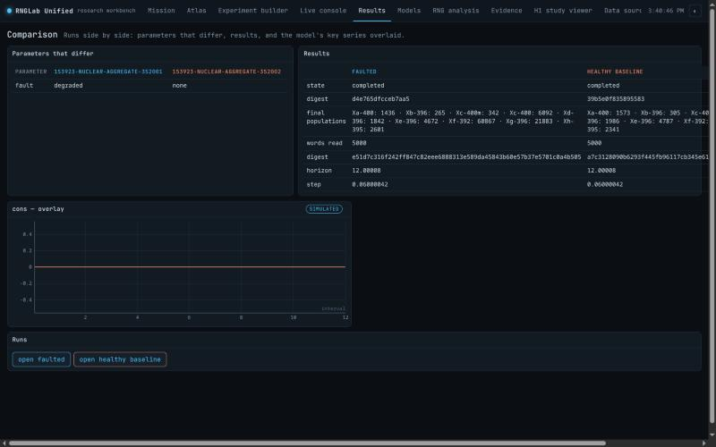
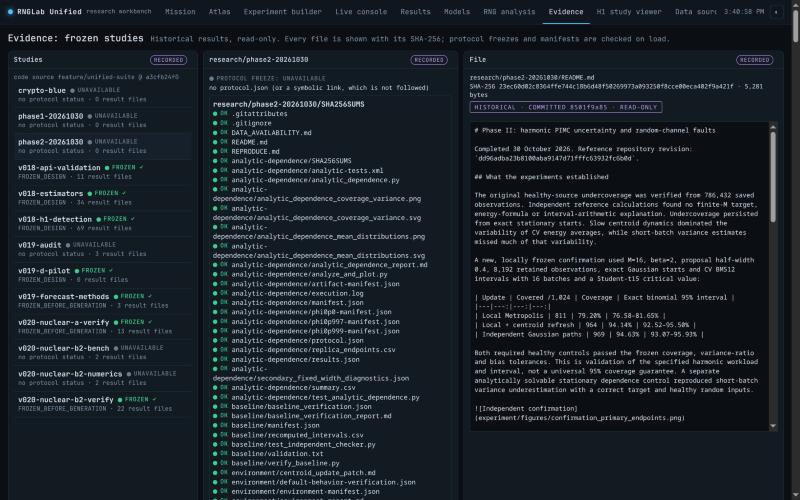
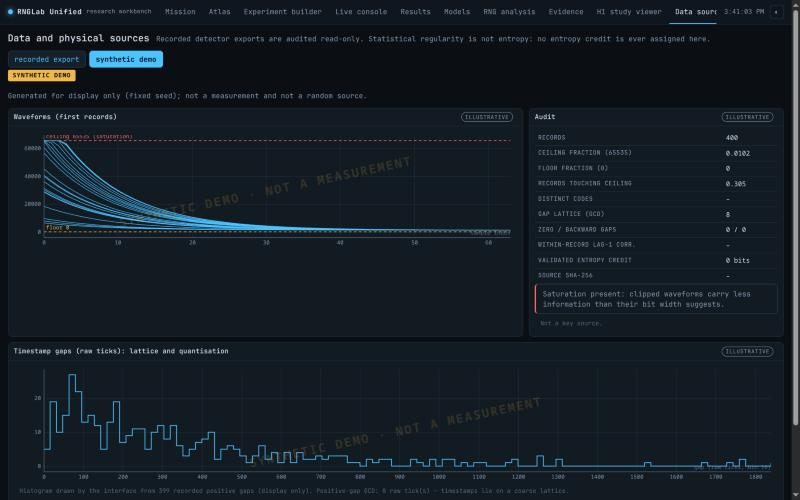
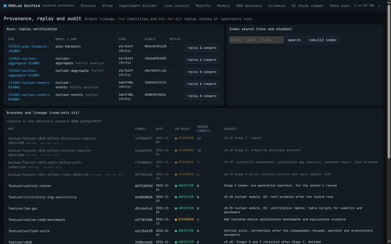

# RNGLab Unified: research workbench

A local-first workbench over RNGLab's research lines. It **runs** a set of RNGLab simulations through
typed worker adapters (each run in its own process, from a chosen Git checkout, with seed namespaces
guarded), **browses** frozen historical studies read-only with SHA-256 freeze checks, and **classifies**
every identified capability with an explicit evidence status.

It integrates through adapters, a capability registry and a code-source mechanism, not through a
source merge: frozen studies, protocols, seeds and result files are read, never changed.

Branch: `feature/unified-suite` (from `e690488`, the tip of `feature/criticality-rng-sensitivity`).

## 1. Install, launch, demonstrate, replay, test

Requirements: the repository's existing virtual environment (Python 3.14, NumPy 2.5.3, built from
`research/phase2-20261030/environment/requirements-lock.txt`). Nothing else is installed: the server
is the Python standard library, and the interface is plain JavaScript with no build step and no
network access.

```bash
.venv/bin/python gui/lab.py --port 8765 --open
```

The server binds to the loopback interface only. Runs are stored under `gui/data/` (git-ignored)
unless `--data-dir DIR` is given.

**Small deterministic demonstration (paired healthy vs faulted, then replay):**

1. Open *Experiment builder* (`g b`) and choose *Radioactive decay, event level (Layer A)*.
2. Set *Fault* to `degraded`, *Bias delta* to `0.05`, *Population* to `5000`, and keep a
   `rnglab-gui-…` namespace.
3. Launch it as a **pair**. The faulted arm and the healthy baseline share the seeds, and only the
   fault differs.
4. Watch both arms in *Live console* (`g c`), then compare them in *Results* (`g r`).
5. In *Provenance* (`g p`), press **replay & compare** on a completed run. This re-runs the same
   configuration in a fresh, unobserved process and compares the official result digest. The result
   is `ok` only if the digest matches and the code source is unchanged.

The same flow through the HTTP API (state-changing requests need the header `X-RNGLab-Lab: 1`):

```bash
curl -s -H 'X-RNGLab-Lab: 1' -d '{"model":"pi-mc","pair":true,"params":{"namespace":"rnglab-gui-explore","label":"demo","samples":20000,"fault":"degraded","bias_delta":0.05}}' http://127.0.0.1:8765/api/runs
```

```bash
curl -s -X POST -H 'X-RNGLab-Lab: 1' http://127.0.0.1:8765/api/runs/<run_id>/verify
```

**Tests:**

```bash
PYTHONPATH=src .venv/bin/python -m pytest tests -q -p no:cacheprovider
```

```bash
PYTHONPATH=src .venv/bin/python -m pytest tests/unified tests/gui -q -p no:cacheprovider
```

**Recorded detector export (opt-in):** a file is read only when it is named on the command line.
The audit is RNGLab's own `rnglab_crypto.sources.physical.audit_waveforms`.

```bash
.venv/bin/python gui/lab.py --detector-file PATH --detector-samples N --detector-provenance "free text"
```

Without a file, *Data sources* shows a placeholder. It also offers a demonstration labelled
**SYNTHETIC DEMO**, with a watermark on every chart.

**Packaging:** there is no separate package. The suite runs from a checkout. `src/rnglab_unified`
is importable with `PYTHONPATH=src`. A desktop wrapper is not implemented.

## 2. Screens

| Screen | Key | What it shows | Data class |
|---|---|---|---|
| Mission | `g d` | evidence classes across capabilities, research lines, frozen studies, recent runs, environment, alerts | recorded + generated, labelled |
| Atlas | `g a` | all capabilities with status, source branch and commit, outcome, constraints, evidence links, code and tests | registry |
| Experiment builder | `g b` | model, random source, fault family and severity, roles, seeds, run length, paired control arm, validation before launch | — |
| Live console | `g c` | active runs, progress, controller state, warnings | simulated |
| Results | `g r` | paired and multi-run comparison over shared axes | simulated / derived / reference |
| Models | `g m` | model-specific panels (PIMC paths, Ising lattice, decay populations and events, H1 monitors, decision ranking) | per panel |
| RNG analysis | — | the bytes each role read at the `RandomSource.read_bytes` boundary | derived |
| Evidence | `g e` | frozen studies, files with SHA-256, protocol freeze and manifest checks, file viewer | **historical, read-only** |
| H1 study viewer | — | v0.18 Stage C cells and runs, recomputed with the study's own `h1lib` from stored arrays | recorded |
| Data sources | `g s` | detector waveforms, saturation, timestamp lattice; a labelled synthetic demo | recorded / illustrative |
| Provenance | `g p` | replay verification, index search, branch lineage (read-only Git) | — |
| Run archive | — | every generated run, telemetry replay player, export | generated |

## 3. Module status

`working`: runs end to end in the workbench through an adapter. `read-only`: stored evidence is
browsed and checked, nothing is executed. `experimental`: works, but is a demonstration or untested
against real data. `planned`: not implemented in the workbench. The *scientific* status of each
capability is a separate field in the Atlas (`docs/unified/capability_matrix.json`). Running a model
here does not change that status.

| Module | Workbench status | Scientific status (matrix) | Notes |
|---|---|---|---|
| Harmonic PIMC (`rnglab12`) | working | experimentally validated at one parameter point (frozen v0.18 API validation reproduced Phase II: 3846/4096 refreshed, 3323/4096 local Metropolis) | Default batch sizes still under-cover. Healthy-PIMC interval undercoverage is an estimator issue, not an RNG fault. |
| H1 detection run (v0.18 Stage C machinery) | working | the Stage C study itself is a negative result for H1-C | uses the frozen gates; its SHA-256 is reported |
| π hit-or-miss | working | implemented (toy) | teaching and plumbing check only |
| Ising 2D (`rnglab14`) | working | unit-tested; exact enumeration for L ≤ 4 | sampler susceptibility uses Var(\|m\|); not compared with the signed-m exact value |
| Decision support | working | unit-tested | |
| Nuclear Layer A, event decay | working | independently verified (frozen A verification: R1 PASS, R2 MET) | synthetic, non-operational |
| Nuclear B2, aggregated decay | working | independently verified (frozen B2 verification: R1 PASS, R2 MET) | the open BT-NEUTRON tail question is shown in the Atlas |
| Nuclear Layers B/C, kinetics, detector response | planned | planned | not implemented anywhere |
| Frozen studies (13 in `research/`) | read-only | per study | 7 recorded protocol freezes verify `ok` |
| v0.16 TRIDENT, v0.17 CALIBRATE | read-only (matrix and inventory) | negative results | outputs are off-repo; only the summaries are inventoried |
| Forecasting (v0.19 prognosis, forecast-methods study) | read-only | conditional under declared models only | no forecaster adapter in the workbench yet |
| Crypto BLUE | read-only | research, not key-generation assurance | no runner adapter yet |
| Detector export audit | experimental | — | consent-gated; **not yet exercised on a real export in this branch** |
| Synthetic detector demo | experimental | illustrative | fixed seed, never stored as a run |
| VMC, finance, native SIMD kernels, Stage D pilot runner | planned | see the Atlas | Stage D pilot is frozen and **not run**; native SIMD is on `feature/native-simd-benchmark` only |
| HPC (Komondor) adapter, live serial hardware | planned | — | never launched automatically |

## 4. Scientific caveats (also enforced in the interface)

- A random-source defect, a sampler defect and an uncertainty-estimation defect are separate failure
  classes. The workbench never relabels one as another.
- Interactive runs sample only in `rnglab-gui-…` namespaces. Study, Stage D pilot and smoke, audit and
  test namespaces are refused, and so is every namespace declared in a `research/*/protocol.json`.
- A replay `ok` means the same digest from the same code in a fresh process on this machine. It is
  not cross-platform reproducibility.
- The nuclear models are synthetic computational-reliability studies, not reactor or facility models.
- Statistical regularity of detector data is not entropy. No entropy credit is assigned.
- Remaining-lifetime forecasts are conditional on a declared degradation model. Unrestricted
  identifiability is not established (see the RUS non-identifiability entry).

## 5. Screenshots (real running interface, 2026-11-22)

| | |
|---|---|
|  |  |
|  |  |
|  |  |
|  | |

## 6. Files

- `src/rnglab_unified/`: taxonomy, registry, evidence browser, index, provenance (stdlib only; never imported by workers)
- `gui/rnglab_gui/`: server, run manager, archive, workers and adapters, interface
- `docs/unified/BRANCH_INVENTORY.md`, `docs/unified/capability_matrix.json`: inventory and evidence matrix
- `docs/unified/ARCHITECTURE.md`: contracts and data flow
- `docs/unified/REVIEW_FINDINGS.md`: review findings, fixes, rejected points, open decisions
- `tests/unified/`, `tests/gui/`: tests
